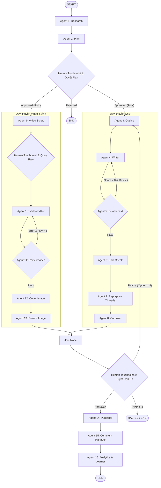

# LINTECH CONTENT OS - SYSTEM ARCHITECTURE & IMPLEMENTATION SPEC

## 1. PROJECT OVERVIEW
- **Tên dự án:** LinTech Content OS (Multi-Agent Multi-Channel Content Production & Distribution)
- **Framework cốt lõi:** LangGraph (StateGraph, Checkpointer, Human-in-the-loop Interrupts)
- **Mô hình kiến trúc:** Đồ thị trạng thái có chu trình (Cyclic StateGraph) kết hợp phân nhánh song song (DAG Fork-Join).
- **Nguyên lý cốt lõi:** 
  1. Tự động hóa tối đa với 16 AI Agents chuyên trách.
  2. Con người là chốt chặn quyết định (Human-in-the-loop) tại đúng 3 điểm: Duyệt Plan tuần, Quay video raw, và Phê duyệt gói nội dung hoàn chỉnh trước khi đăng.
  3. Cơ chế tự sửa sai (Self-Correction Loop) với giới hạn số lần lặp (Loop Breaker / Recursion Guards) chống tràn token.

---

## 2. DIRECTORY TREE CONVENTION
Mọi code tạo ra PHẢI tuân thủ nghiêm ngặt cấu trúc modular:

```text
content_os/
├── config.py                     # Quản lý LLM instances (LLM_CORE, LLM_FAST) & env vars
├── requirements.txt              # Thư viện phụ thuộc
├── .env                          # API keys
├── PROJECT_SPEC.md               # Tài liệu đặc tả này
├── core/
│   ├── __init__.py
│   ├── state.py                  # TypedDict ContentOSState & Pydantic Schemas
│   └── checkpointer.py           # SQLite/Memory checkpointer cho LangGraph
├── agents/
│   ├── planning/
│   │   ├── research_agent.py     # Agent 1: Quét xu hướng, tin tức
│   │   └── planner_agent.py      # Agent 2: Lập ma trận 5-7 bài/tuần
│   ├── text_pipeline/
│   │   ├── outline_agent.py      # Agent 3: Dàn ý Hook - Body - CTA
│   │   ├── writer_agent.py       # Agent 4: Chấp bút chuẩn Brand Voice
│   │   ├── review_agent.py       # Agent 5: Chấm điểm (0-10) & đánh giá
│   │   ├── factcheck_agent.py    # Agent 6: Rà soát chính tả, số liệu
│   │   ├── repurpose_agent.py    # Agent 7: Tách chuỗi Threads (3-5 post)
│   │   └── carousel_agent.py     # Agent 8: Soạn kịch bản slide (5-7 trang)
│   ├── media_pipeline/
│   │   ├── script_agent.py       # Agent 9: Kịch bản video 30-50s + visual cues
│   │   ├── video_editor.py       # Agent 10: Auto-cut, sub, B-roll, SFX API mock/tool
│   │   ├── review_video.py       # Agent 11: Kiểm định thời lượng & phụ đề
│   │   ├── cover_agent.py        # Agent 12: Prompt & layout ảnh bìa 3:4 / 9:16
│   │   └── review_image.py       # Agent 13: Duyệt nhận diện thương hiệu
│   └── operations/
│       ├── publisher_agent.py    # Agent 14: API đăng đa kênh (FB, TikTok, Threads, Shorts)
│       ├── community_agent.py    # Agent 15: Phân loại & trả lời bình luận theo CTA
│       └── analytics_agent.py    # Agent 16: Phân tích chỉ số tuần & tự cập nhật Brand Brain
├── graph/
│   ├── __init__.py
│   ├── nodes.py                  # Đóng gói các hàm node gọi Agent
│   ├── edges.py                  # Các hàm điều kiện rẽ nhánh & vòng lặp
│   └── workflow.py               # Biên dịch StateGraph và Compile App
└── main.py                       # CLI Test & Stream Runner
```

---

## 3. SHARED STATE SPECIFICATION (core/state.py)
Tất cả các node trong LangGraph PHẢI giao tiếp qua cấu trúc ContentOSState dưới đây:

```python
from typing import List, Dict, Optional, Any, Annotated
from typing_extensions import TypedDict
import operator

class ContentOSState(TypedDict):
    # 1. Metadata & Memory
    week_id: str
    brand_rules: Annotated[List[str], operator.add]
    
    # 2. Chặng 1: Planning
    trends_feed: List[Dict[str, Any]]
    content_plan: List[Dict[str, Any]]
    plan_approved: bool                  # Human Touchpoint 1
    
    # 3. Chặng 2A: Dây chuyền Chữ
    selected_topic: Dict[str, Any]
    outline: Dict[str, Any]
    raw_draft: str
    draft_score: int                     # Thang điểm 0 - 10
    draft_feedback: str                  # Nhận xét từ Agent 5
    text_revision_count: int             # Guard: Max 2
    fact_checked_draft: str
    threads_posts: List[str]
    carousel_slides: List[Dict[str, Any]]
    
    # 4. Chặng 2B: Dây chuyền Video & Ảnh
    video_script: Dict[str, Any]
    raw_footage_url: Optional[str]       # Human Touchpoint 2 (User quay video thả Drive)
    rendered_video_url: Optional[str]
    video_duration: int                  # Yêu cầu < 60s
    video_approved: bool
    video_revision_count: int            # Guard: Max 1
    cover_image_url: Optional[str]
    image_approved: bool
    image_revision_count: int            # Guard: Max 2
    
    # 5. Chặng 3: Xuất bản & Điều hành
    final_package_approved: bool         # Human Touchpoint 3 (Duyệt trọn bộ)
    user_revision_note: Optional[str]
    total_cycle_count: int               # Guard: Max 4
    published_links: Dict[str, str]
    
    # 6. Chặng 4: Đo lường & Vòng học tuần
    weekly_metrics: Dict[str, Any]
```

---

## 4. MA TRẬN 16 AGENT & 3 HUMAN TOUCHPOINTS

### Tầng 1: Lên Kế Hoạch (Planning Layer)
- **Agent 1 (Research):** Quét tin tức, radar đối thủ, xuất ra 5 chủ đề xu hướng.
- **Agent 2 (Plan):** Lập lịch 5-7 bài/tuần dạng brief: `{id, angle, hook_concept, target_channel}`.
- 🔶 **HUMAN TOUCHPOINT 1 (Duyệt Plan):** Dùng `interrupt()`. Nếu user duyệt -> Chạy song song Dây chuyền Chữ và Dây chuyền Video. Nếu từ chối -> Kết thúc luồng (END).

### Tầng 2: Dây chuyền Chữ (Text Pipeline)
- **Agent 3 (Dàn ý):** Tạo outline cấu trúc: Hook (3 biến thể) - Thân bài - CTA.
- **Agent 4 (Viết):** Chấp bút bài Facebook theo Brand Voice Guidelines.
- **Agent 5 (Duyệt bài - QA):** Chấm điểm bài viết:
  - **Điều kiện:** Nếu `draft_score < 8` VÀ `text_revision_count < 2` -> Trả về Agent 4 kèm `draft_feedback` để viết lại.
  - **Điều kiện thoát:** Nếu `draft_score >= 8` HOẶC `text_revision_count >= 2` -> Cho phép đi tiếp sang Agent 6.
- **Agent 6 (Kiểm chứng):** Soát lỗi chính tả, xác minh số liệu, quét từ khóa vi phạm chính sách Meta/TikTok.
- **Agent 7 (Nhân bản Threads):** Chuyển nội dung thành chuỗi 3-5 post ngắn cho Threads.
- **Agent 8 (Carousel):** Cắt lát thành kịch bản slide ảnh (5-7 trang).

### Tầng 3: Dây chuyền Video & Ảnh (Visual Pipeline)
- **Agent 9 (Kịch bản Video):** Xuất bảng kịch bản 30-50s (Thời gian, Visual Cue, Lời thoại/Voice prompter).
- 🔶 **HUMAN TOUCHPOINT 2 (Quay Clip):** Dùng `interrupt()`. Dừng luồng chờ user đọc kịch bản, tự quay clip và nạp link Google Drive vào state (`raw_footage_url`).
- **Agent 10 (Dựng Video):** Cắt khoảng lặng, sync audio, chèn subtitle tự động, chèn B-roll và SFX.
- **Agent 11 (Duyệt Video - QA):** Kiểm tra kỹ thuật: Thời lượng < 60s, khớp phụ đề. Nếu lỗi VÀ `video_revision_count < 1` -> Render lại.
- **Agent 12 (Ảnh Bìa):** Tạo prompt & render thumbnail tỉ lệ 3:4 và 9:16.
- **Agent 13 (Duyệt Ảnh - QA):** Kiểm tra font chữ, vị trí safe-zone, logo và màu sắc thương hiệu.

### Tầng 4: Hội tụ & Xuất bản (Publishing Layer)
- 🔶 **HUMAN TOUCHPOINT 3 (Duyệt Bộ Nội Dung):** Dùng `interrupt()`. Gom toàn bộ Text, Threads, Video, Cover thành 1 bản xem trước (Preview Payload).
  - Nếu User bấm Duyệt (`approved=True`) -> Đi tiếp sang Agent 14.
  - Nếu User ghi chú sửa (`note`) VÀ `total_cycle_count <= 4` -> Định tuyến quay lại dây chuyền sửa.
  - Nếu `total_cycle_count > 4` -> Chuyển trạng thái HALTED (Dừng khẩn cấp).
- **Agent 14 (Đăng bài):** Bắn API xuất bản đa kênh theo lịch (Facebook, TikTok, Shorts, Threads).
- **Agent 15 (Bình luận):** Lọc bình luận theo từ khóa CTA, tự động seeding câu hỏi và phản hồi giải đáp.

### Tầng 5: Đo lường & Vòng học tuần (Analytics & Brain Updating)
- **Agent 16 (Phân tích & Tối ưu):** Sau 7 ngày, tổng hợp chỉ số tương tác, xác định góc bài viết (Angle) chiến thắng, tự động rút ra các bài học mới và bổ sung vào `brand_rules` trong State để chu kỳ tuần sau thông minh hơn.

---

## 5. GRAPH ROUTING & CONDITIONAL EDGES SPECIFICATION

### Luồng điều hướng tổng quát:
- `START` -> `research` -> `plan` -> `human_approve_plan`

### Các nút điều kiện & Rẽ nhánh:
1. **`human_approve_plan` (Conditional Edge):**
   - Nếu `plan_approved == True`: Fork song song thành 2 nhánh `[outline, video_script]`.
   - Nếu `False`: Chuyển tới `END`.

2. **Dây chuyền Chữ (Text Pipeline):**
   - `outline` -> `writer` -> `review_text`
   - **`review_text` (Conditional Edge):**
     - Nếu `draft_score < 8` VÀ `text_revision_count < 2`: Vòng lặp quay lại `writer`.
     - Ngược lại (`draft_score >= 8` HOẶC `text_revision_count >= 2`): Sang `fact_check` -> `repurpose_threads` -> `carousel` -> `join_node`.

3. **Dây chuyền Video & Ảnh (Visual Pipeline):**
   - `video_script` -> `human_record_video` -> `video_editing` -> `review_video`
   - **`review_video` (Conditional Edge):**
     - Nếu lỗi VÀ `video_revision_count < 1`: Quay lại `video_editing`.
     - Ngược lại (`video_approved == True` HOẶC `video_revision_count >= 1`): Sang `cover_image` -> `review_image` -> `join_node`.

4. **Hội tụ & Phê duyệt xuất bản:**
   - `join_node` (Hội tụ 2 nhánh Text & Visual) -> `human_approve_final_package`.
   - **`human_approve_final_package` (Conditional Edge):**
     - Nếu `final_package_approved == True`: Sang `publisher` -> `comment_manager` -> `analytics_learner` -> `END`.
     - Nếu cần sửa: Quay về nhánh tương ứng dựa trên `user_revision_note` (Text Pipeline hoặc Visual Pipeline) với điều kiện `total_cycle_count <= 4`.
     - Nếu `total_cycle_count > 4`: Chuyển sang trạng thái `HALTED` / `END`.




