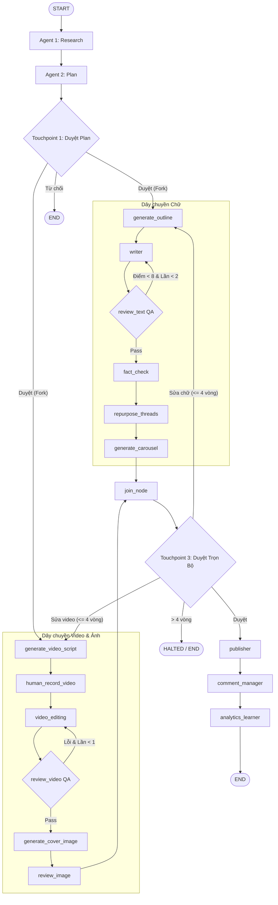

# POTA CONTENT OS - SYSTEM ARCHITECTURE & IMPLEMENTATION SPEC

## 1. PROJECT OVERVIEW
- **Tên dự án:** POTA Content OS (Multi-Agent Multi-Channel Content Production & Distribution System)
- **Framework cốt lõi:** LangGraph (Cyclic StateGraph, MemorySaver Checkpointer, Human-in-the-loop Interrupts)
- **Mô hình kiến trúc:** Đồ thị trạng thái có chu trình kết hợp phân nhánh song song (DAG Fork-Join).
- **Nguyên lý cốt lõi:** 
  1. **Tự động hóa tối đa với 16 AI Agents chuyên trách:** Phân tầng rõ ràng: Lập kế hoạch $\to$ Dây chuyền Chữ $\to$ Dây chuyền Video & Ảnh $\to$ Xuất bản $\to$ Đo lường & Học máy tuần.
  2. **Con người là chốt chặn quyết định (Human-in-the-loop) tại đúng 3 điểm ngắt:**
     - 🔶 **Touchpoint 1:** Duyệt Plan tuần & Lựa chọn bài viết hoặc gõ chủ đề tùy chỉnh.
     - 🔶 **Touchpoint 2:** Creator nhận kịch bản, quay clip thô và nạp link video footage.
     - 🔶 **Touchpoint 3:** Duyệt trọn gói gói ấn phẩm đa phương tiện hoàn thiện trước khi xuất bản.
  3. **Cơ chế tự sửa sai (Self-Correction Loop) với Loop Breakers chống tràn token:**
     - QA bài viết viết lại nếu điểm < 8 (Tối đa 2 lần).
     - QA video render lại nếu lỗi kỹ thuật (Tối đa 1 lần).
     - Duyệt trọn bộ lặp lại tối đa 4 chu kỳ (`total_cycle_count > 4 -> HALTED`).
  4. **Cơ chế chống xung đột State trong nhánh song song:** Các node chạy đồng thời không ghi đè cùng một state key không reducer.

---

## 2. DIRECTORY TREE CONVENTION
Code tuân thủ cấu trúc modular, tách biệt rõ ràng giữa Agent logic, Graph routing, và Interfaces:

```text
content_os/
├── config.py                     # Quản lý LLM instances (Gemini, OpenAI, MockLLM) & env vars
├── requirements.txt              # Thư viện phụ thuộc (langgraph, google-genai, pydantic...)
├── .env.example                  # Mẫu cấu hình API keys & model defaults
├── .gitignore                    # Bỏ qua venv, cache, file bảo mật
├── README.md                     # Hướng dẫn cài đặt, thiết lập máy mới và chạy hệ thống
├── PROJECT_SPEC.md               # Tài liệu đặc tả kỹ thuật chi tiết
├── core/
│   ├── __init__.py
│   ├── state.py                  # TypedDict ContentOSState & Pydantic V2 Schemas
│   └── checkpointer.py           # MemorySaver checkpointer cho LangGraph
├── agents/
│   ├── planning/
│   │   ├── research_agent.py     # Agent 1: Quét xu hướng & radar đối thủ (hỗ trợ focus_topic)
│   │   └── planner_agent.py      # Agent 2: Lập ma trận 5-7 bài/tuần
│   ├── text_pipeline/
│   │   ├── outline_agent.py      # Agent 3: Dàn ý Hook (3 biến thể) - Thân bài - CTA
│   │   ├── writer_agent.py       # Agent 4: Chấp bút chuẩn Brand Voice
│   │   ├── review_agent.py       # Agent 5: Chấm điểm QA (0-10) & đánh giá
│   │   ├── factcheck_agent.py    # Agent 6: Rà soát chính tả, số liệu & chính sách
│   │   ├── repurpose_agent.py    # Agent 7: Tách chuỗi Threads (3-5 post)
│   │   └── carousel_agent.py     # Agent 8: Soạn kịch bản slide (5-7 trang)
│   ├── media_pipeline/
│   │   ├── script_agent.py       # Agent 9: Kịch bản video dọc 30-50s + visual cues
│   │   ├── video_editor.py       # Agent 10: Auto-cut, sub, B-roll, SFX API interface
│   │   ├── review_video.py       # Agent 11: Kiểm định thời lượng (< 60s) & phụ đề
│   │   ├── cover_agent.py        # Agent 12: Prompt & layout ảnh bìa 3:4 / 9:16
│   │   └── review_image.py       # Agent 13: Duyệt nhận diện thương hiệu & safe-zone
│   └── operations/
│       ├── publisher_agent.py    # Agent 14: API đăng đa kênh (FB, TikTok, Threads, Shorts)
│       ├── community_agent.py    # Agent 15: Phân loại & trả lời bình luận theo CTA
│       └── analytics_agent.py    # Agent 16: Phân tích chỉ số tuần & tự cập nhật Brand Brain
├── graph/
│   ├── __init__.py
│   ├── nodes.py                  # Đóng gói các hàm node gọi Agent & 3 Touchpoints
│   ├── edges.py                  # Các hàm điều kiện rẽ nhánh, vòng lặp & loop breaker
│   └── workflow.py               # Biên dịch StateGraph và Compile App
├── tests/
│   ├── test_state_and_planning.py    # Unit test Phase 1 (State & Planning)
│   ├── test_phase2_graph.py          # Unit test Phase 2 (Touchpoint 1)
│   ├── test_phase3_text_pipeline.py  # Unit test Phase 3 (Text Self-Correction)
│   ├── test_phase4_media_pipeline.py # Unit test Phase 4 (Media & DAG Fork-Join)
│   └── test_phase5_operations.py     # Unit test Phase 5 (Operations & End-to-End)
├── ui/
│   ├── index.html                # Giao diện Visual Dashboard điều khiển luồng
│   ├── style.css                 # Thiết kế Dark Mode, Neon Glow, Glassmorphism
│   └── app.js                    # Logic realtime kết nối và điều khiển đồ thị
├── server.py                     # HTTP & REST API Server phục vụ Web Dashboard
└── main.py                       # Interactive CLI Test & Stream Runner
```

---

## 3. SHARED STATE SPECIFICATION (core/state.py)
Tất cả các node trong LangGraph giao tiếp đồng bộ qua cấu trúc `ContentOSState`:

```python
from typing import List, Dict, Optional, Any, Annotated
from typing_extensions import TypedDict
import operator

class ContentOSState(TypedDict):
    # 1. Metadata & Continuous Learning Memory
    week_id: str
    brand_rules: Annotated[List[str], operator.add]  # Reducer tự động cộng dồn bài học mới
    
    # 2. Chặng 1: Planning
    trends_feed: List[Dict[str, Any]]
    content_plan: List[Dict[str, Any]]
    plan_approved: bool                  # Human Touchpoint 1
    
    # 3. Chặng 2A: Dây chuyền Chữ
    selected_topic: Dict[str, Any]
    outline: Dict[str, Any]
    raw_draft: str
    draft_score: int                     # Thang điểm 0 - 10
    draft_feedback: str                  # Nhận xét từ Agent 5
    text_revision_count: int             # Guard: Max 2 lần sửa
    fact_checked_draft: str
    threads_posts: List[str]
    carousel_slides: List[Dict[str, Any]]
    
    # 4. Chặng 2B: Dây chuyền Video & Ảnh
    video_script: Dict[str, Any]
    raw_footage_url: Optional[str]       # Human Touchpoint 2 (Creator nạp link Google Drive)
    rendered_video_url: Optional[str]
    video_duration: int                  # Yêu cầu < 60s
    video_approved: bool
    video_revision_count: int            # Guard: Max 1 lần render lại
    cover_image_url: Optional[str]
    image_approved: bool
    image_revision_count: int            # Guard: Max 2
    
    # 5. Chặng 3: Xuất bản & Điều hành
    final_package_approved: bool         # Human Touchpoint 3 (Duyệt trọn gói)
    user_revision_note: Optional[str]
    total_cycle_count: int               # Guard: Max 4 chu kỳ trước khi HALTED
    published_links: Dict[str, str]      # Canonical URLs (FB, TikTok, Threads, Shorts)
    
    # 6. Chặng 4: Đo lường & Vòng học tuần
    weekly_metrics: Dict[str, Any]
```

---

## 4. MA TRẬN 16 AGENT & 3 HUMAN TOUCHPOINTS

### Tầng 1: Lên Kế Hoạch (Planning Layer)
- **Agent 1 (Research):** Quét tin tức, radar đối thủ. Nếu có chủ đề yêu cầu (`focus_topic`), tập trung quét sâu các khía cạnh và số liệu xoay quanh chủ đề đó.
- **Agent 2 (Plan):** Lập lịch 5-7 bài/tuần dạng brief: `{id, angle, hook_concept, target_channel, target_audience, core_message}`.
- 🔶 **HUMAN TOUCHPOINT 1 (Duyệt Plan):** Dùng `interrupt()`.
  - Người dùng có thể: Chọn bài viết muốn triển khai ngay (chỉ số 1-N), hoặc nhập chủ đề tùy chỉnh hoàn toàn mới, hoặc từ chối kế hoạch (END).

### Tầng 2: Dây chuyền Chữ (Text Pipeline)
- **Agent 3 (Dàn ý - node: `generate_outline`):** Tạo outline: Hook (3 biến thể) - Thân bài - CTA.
- **Agent 4 (Viết - node: `writer`):** Chấp bút bài Facebook theo Brand Voice Guidelines.
- **Agent 5 (Duyệt bài QA - node: `review_text`):** Chấm điểm 0-10:
  - Nếu `draft_score < 8` VÀ `text_revision_count < 2` $\to$ Quay lại Agent 4 kèm góp ý.
  - Thoát: Nếu `draft_score >= 8` HOẶC `text_revision_count >= 2` $\to$ Sang Agent 6.
- **Agent 6 (Kiểm chứng - node: `fact_check`):** Soát lỗi chính tả, số liệu, quét từ khóa vi phạm chính sách Meta/TikTok.
- **Agent 7 (Nhân bản Threads - node: `repurpose_threads`):** Tạo chuỗi 3-5 post ngắn cho Threads.
- **Agent 8 (Carousel - node: `generate_carousel`):** Soạn kịch bản slide ảnh (5-7 trang) $\to$ Hội tụ tại `join_node`.

### Tầng 3: Dây chuyền Video & Ảnh (Visual Pipeline)
- **Agent 9 (Kịch bản Video - node: `generate_video_script`):** Xuất kịch bản 30-50s (Visual cues, lời thoại máy nhắc chữ).
- 🔶 **HUMAN TOUCHPOINT 2 (Quay Clip - node: `human_record_video`):** Dùng `interrupt()`. Dừng luồng chờ Creator nạp link video thô (`raw_footage_url`).
- **Agent 10 (Dựng Video - node: `video_editing`):** Cắt khoảng lặng, sync audio, chèn subtitle tự động, B-roll.
- **Agent 11 (Duyệt Video QA - node: `review_video`):** Thời lượng < 60s, khớp phụ đề. Nếu lỗi và `video_revision_count < 1` $\to$ Render lại.
- **Agent 12 (Ảnh Bìa - node: `generate_cover_image`):** Tạo prompt & render thumbnail tỉ lệ 3:4 và 9:16.
- **Agent 13 (Duyệt Ảnh QA - node: `review_image`):** Kiểm tra nhận diện thương hiệu & safe-zone $\to$ Hội tụ tại `join_node`.

### Tầng 4: Hội tụ & Xuất bản (Publishing Layer)
- **Convergence Node (`join_node`):** Đồng bộ hóa dữ liệu từ cả 2 nhánh chạy song song.
- 🔶 **HUMAN TOUCHPOINT 3 (Duyệt Trọn Gói - node: `human_approve_final_package`):** Dùng `interrupt()`.
  - Hiển thị đầy đủ bản xem trước (Facebook, Threads, Carousel, Video, Cover).
  - Nếu `approved == True` $\to$ Chuyển sang `publisher`.
  - Nếu yêu cầu sửa VÀ `total_cycle_count <= 4` $\to$ Quay về nhánh tương ứng sửa lại.
  - Nếu `total_cycle_count > 4` $\to$ Kích hoạt dừng khẩn cấp **HALTED / END**.
- **Agent 14 (Đăng bài - node: `publisher`):** Xuất bản đa kênh đồng bộ (Facebook, TikTok, Shorts, Threads).
- **Agent 15 (Bình luận - node: `comment_manager`):** Chuẩn bị kịch bản phản hồi bình luận theo từ khóa CTA và gieo mầm thảo luận.

### Tầng 5: Đo lường & Vòng học tuần (Analytics & Continuous Learning)
- **Agent 16 (Phân tích & Tối ưu - node: `analytics_learner`):** Tổng hợp tương tác tuần, xác định góc bài viết thắng lợi, tự động đúc rút quy tắc mới bổ sung vào `brand_rules` $\to$ Hoàn tất chu trình (**END**).

---

## 5. LANGGRAPH ROUTING & SAFETY GUARDS



---

## 7. ĐẶC TẢ TẦNG OPERATIONS & KẾT QUẢ ĐẦU RA (OPERATIONS LAYER SPEC)

### 7.1. Agent 14: Publisher Agent & Multi-Channel Service Architecture
- **Trách nhiệm:** Xuất bản đồng bộ gói nội dung đã duyệt lên 4 kênh (Facebook Post, TikTok Video 9:16, Threads Series, YouTube Shorts).
- **Mô hình kiến trúc (Clean Architecture):** Tách biệt logic nghiệp vụ qua `PublisherService` interface trừu tượng:
  - `DefaultPublisherService`: Cơ chế Sandbox sinh Canonical Mock URLs định danh duy nhất (`https://facebook.com/pota/posts/{hash}`) phục vụ kiểm thử nội bộ tự động và CI/CD.
  - `ProductionPublisherService` (Sẵn sàng tích hợp API thực tế): Nhận `PAGE_ACCESS_TOKEN` (Meta Graph API) hoặc `AYRSHARE_API_KEY` để đăng trực tiếp lên Fanpage/Kênh thật.

### 7.2. Agent 15: Community & Comment Manager
- **Trách nhiệm:** Tạo kịch bản auto-reply và seeding thảo luận cộng đồng bám sát lời kêu gọi hành động (CTA) của bài viết, tối ưu hóa tỷ lệ chuyển đổi Leads.

### 7.3. Agent 16: Analytics & "Brand Brain" Continuous Learner
- **Trách nhiệm:** Tổng hợp và đánh giá chỉ số tương tác tuần (Reach, Views, Retention, CTA Comments, Leads) và nhận diện các góc tiếp cận thành công (Winning Angles).
- **Cơ chế tự học (Brand Brain Self-Evolution):**
  - Trích xuất 1-2 bài học thực chiến súc tích thành các quy tắc mới (`learned_rules`).
  - Nạp tự động vào trường `brand_rules` trong `ContentOSState` thông qua reducer `Annotated[List[str], operator.add]`.
  - Bộ quy tắc tích lũy này tự động truyền vào chu kỳ sản xuất tuần kế tiếp, giúp hệ thống ngày càng thấu hiểu sở thích khán giả mà không cần cấu hình lại thủ công.

### 7.4. Giao diện trực quan hóa Báo cáo (Visual Dashboard Integration)
- Modal **"BÁO CÁO ĐO LƯỜNG HIỆU QUẢ TUẦN & BRAND BRAIN"** (`#modalAnalyticsReport`) trên Web UI:
  - Tự động kích hoạt khi đồ thị hoàn thành Chặng 5 (Agent 16 kết thúc).
  - Cho phép người dùng truy cập mọi lúc bằng cách click vào node `Agent 16: Phân tích` hoặc `Brand Brain tự cập nhật` trên sơ đồ luồng.
  - Cung cấp tính năng sao chép toàn bộ ấn phẩm và liên kết ra Clipboard với 1 nút bấm (`copyPublishedSummary()`).
