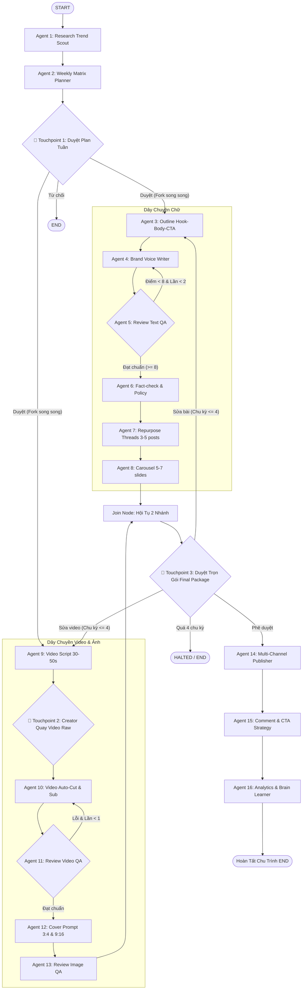

# 🚀 LinTech Content OS

> **Hệ thống Multi-Agent Tự Động Hóa Sản Xuất & Phân Phối Nội Dung Đa Kênh Khép Kín**  
> Xây dựng trên nền tảng **LangGraph (Cyclic StateGraph + DAG Fork-Join)** với kiến trúc 16 AI Agents chuyên trách và 3 Human Touchpoints.

---

## 📋 Mục Lục
1. [Tổng quan hệ thống](#-tổng-quan-hệ-thống)
2. [Cấu trúc ma trận 16 Agents & 3 Human Touchpoints](#-cấu-trúc-ma-trận-16-agents--3-human-touchpoints)
3. [Hướng dẫn cài đặt trên máy mới](#-hướng-dẫn-cài-đặt-trên-máy-mới)
4. [Hướng dẫn sử dụng](#-hướng-dẫn-sử-dụng)
5. [Cấu trúc thư mục dự án](#-cấu-trúc-thư-mục-dự-án)
6. [Cơ chế tự sửa bài & Loop Breakers](#-cơ-chế-tự-sửa-bài--loop-breakers)
7. [Chạy kiểm thử tự động (Unit & Integration Tests)](#-chạy-kiểm-thử-tự-động)

---

## 🌟 Tổng Quan Hệ Thống

LinTech Content OS giải phóng 80% thời gian sản xuất nội dung hàng tuần cho Solopreneurs và Tech Founders bằng cách:
- Tự động quét radar tin tức và đối thủ để lên lịch ma trận 5-7 bài viết đa kênh.
- Phân nhánh song song (**Parallel DAG Fork-Join**):
  - **Dây chuyền Chữ (Text Pipeline):** Lập dàn ý $\to$ Viết bài $\to$ Tự chấm điểm & sửa bài $\to$ Soát lỗi & chính sách $\to$ Nhân bản Threads (3-5 posts) $\to$ Kịch bản Carousel (5-7 trang).
  - **Dây chuyền Video & Ảnh (Visual Pipeline):** Kịch bản video dọc 30-50s $\to$ Creator quay thô $\to$ Auto-cut, ghép sub & B-roll $\to$ QA kỹ thuật $\to$ Prompt ảnh cover 3:4 & 9:16 $\to$ QA nhận diện thương hiệu.
- Hội tụ dữ liệu để con người duyệt trọn gói (Human Touchpoint 3).
- Bắn API xuất bản đa kênh (**Facebook, TikTok, Threads, YouTube Shorts**).
- Tự động lên kịch bản chăm sóc bình luận, điều hướng link CTA.
- Đo lường chỉ số tuần và **tự cập nhật bài học mới vào Brand Brain** (Continuous Learning Loop).

---

## 🤖 Cấu Trúc Ma Trận 16 Agents & 3 Human Touchpoints



---

## 💻 Hướng Dẫn Cài Đặt Trên Máy Mới

### 1. Yêu cầu tiên quyết
- **Python:** 3.10 trở lên (khuyên dùng Python 3.11 hoặc 3.12, tương thích cả Python 3.15).
- **Git:** Đã cài đặt trên máy.

### 2. Tải mã nguồn (Clone repository)
```bash
git clone https://github.com/phongnt911/content_os.git
cd content_os
```

### 3. Khởi tạo môi trường ảo (Virtual Environment)
- **Trên Windows (PowerShell / Command Prompt):**
  ```powershell
  python -m venv venv
  .\venv\Scripts\activate
  ```
- **Trên macOS / Linux:**
  ```bash
  python3 -m venv venv
  source venv/bin/activate
  ```

### 4. Cài đặt các thư viện phụ thuộc
```bash
pip install -r requirements.txt
```

### 5. Cấu hình file môi trường `.env`
Tạo file `.env` tại thư mục gốc (hoặc copy từ `.env.example`):
```bash
cp .env.example .env
```
Mở file `.env` và điền API Key của bạn:
```ini
# Ưu tiên Google Gemini (Khuyên dùng gemini-3.5-flash-lite, tốc độ cao và miễn phí)
GOOGLE_API_KEY=your_google_gemini_api_key_here

# Hoặc OpenAI
OPENAI_API_KEY=your_openai_api_key_here

# Cấu hình model mặc định
LLM_CORE_MODEL=gemini-3.5-flash-lite
LLM_FAST_MODEL=gemini-3.5-flash-lite
LLM_TEMPERATURE=0.7

# Tuần mặc định
DEFAULT_WEEK_ID=2026-W42
```
> **Lưu ý:** Hệ thống đã tích hợp sẵn cơ chế **MockLLM Fallback thông minh**. Kể cả khi chưa có API Key hoặc hết quota (429), toàn bộ luồng đồ thị và các test case vẫn tự động chạy mượt mà mà không bị crash.

---

## 🎯 Hướng Dẫn Sử Dụng

### 1. Chạy tương tác qua Terminal (Interactive CLI)
```bash
python main.py
```
Quy trình tương tác trực quan:
1. **Khởi tạo chủ đề:** Bạn có thể nhập một chủ đề/từ khóa muốn làm trong tuần (ví dụ: *"Tự động hóa n8n và LangGraph"*), hoặc bấm **Enter** để AI tự động quét tin tức và radar đối thủ.
2. **Touchpoint 1 (Duyệt Plan tuần):**
   - Nhập số `1` đến `6` để chọn chính xác bài viết muốn sản xuất ngay trong tuần.
   - Nhập `Y` để lấy bài số 1 mặc định.
   - Nhập `C` để gõ một chủ đề tùy chỉnh mới.
   - Nhập `N` để từ chối kế hoạch.
3. **Touchpoint 2 (Quay Video Raw):**
   - Đọc kịch bản 30-50s do Agent 9 soạn (Visual cues, lời thoại máy nhắc chữ).
   - Dán URL Google Drive video thô của bạn (hoặc bấm **Enter** để dùng video mẫu demo).
4. **Touchpoint 3 (Duyệt Trọn Gói):**
   - Xem trước toàn bộ ấn phẩm: Bài Facebook, chuỗi bài Threads, Carousel slides, Video render, Ảnh bìa cover.
   - Nhập `Y` để phê duyệt xuất bản ngay!
   - Nhập `R` để yêu cầu chỉnh sửa kèm lý do.
5. **Hoàn tất:** Hệ thống xuất bản đa kênh, hiển thị link bài đăng Facebook/TikTok/Threads/Shorts, kịch bản trả lời comment và các bài học mới được bổ sung vào Brand Brain.

### 2. Chạy tự động không dừng (Non-interactive Demo)
Dùng để chạy demo nhanh hoặc kiểm thử CI/CD:
```bash
python main.py --auto
```

---

## 📁 Cấu Trúc Thư Mục Dự Án

```text
content_os/
├── config.py                     # Quản lý LLM (Gemini, OpenAI, MockLLM) & env vars
├── requirements.txt              # Danh sách thư viện Python
├── .env.example                  # Mẫu cấu hình API keys
├── .gitignore                    # Bỏ qua venv, cache, file bảo mật
├── README.md                     # Tài liệu hướng dẫn này
├── PROJECT_SPEC.md               # Tài liệu đặc tả kỹ thuật chi tiết
├── core/
│   ├── __init__.py
│   ├── state.py                  # ContentOSState TypedDict & Pydantic V2 Schemas
│   └── checkpointer.py           # MemorySaver checkpointer cho LangGraph
├── agents/
│   ├── planning/
│   │   ├── research_agent.py     # Agent 1: Quét xu hướng & đối thủ
│   │   └── planner_agent.py      # Agent 2: Lập ma trận 5-7 bài/tuần
│   ├── text_pipeline/
│   │   ├── outline_agent.py      # Agent 3: Dàn ý Hook - Body - CTA
│   │   ├── writer_agent.py       # Agent 4: Chấp bút chuẩn Brand Voice
│   │   ├── review_agent.py       # Agent 5: Chấm điểm QA (0-10)
│   │   ├── factcheck_agent.py    # Agent 6: Soát chính tả & chính sách
│   │   ├── repurpose_agent.py    # Agent 7: Tách chuỗi Threads (3-5 post)
│   │   └── carousel_agent.py     # Agent 8: Soạn kịch bản slide (5-7 trang)
│   ├── media_pipeline/
│   │   ├── script_agent.py       # Agent 9: Kịch bản video dọc 30-50s
│   │   ├── video_editor.py       # Agent 10: Auto-cut, sub, B-roll interface
│   │   ├── review_video.py       # Agent 11: QA thời lượng < 60s & phụ đề
│   │   ├── cover_agent.py        # Agent 12: Prompt & layout ảnh bìa 3:4 / 9:16
│   │   └── review_image.py       # Agent 13: QA nhận diện thương hiệu
│   └── operations/
│       ├── publisher_agent.py    # Agent 14: API đăng đa kênh (FB, TikTok, Threads, Shorts)
│       ├── community_agent.py    # Agent 15: Phân loại & trả lời bình luận theo CTA
│       └── analytics_agent.py    # Agent 16: Phân tích tuần & tự bổ sung Brand Rules
├── graph/
│   ├── __init__.py
│   ├── nodes.py                  # Đóng gói các node trong đồ thị LangGraph
│   ├── edges.py                  # Các hàm điều kiện rẽ nhánh & vòng lặp
│   └── workflow.py               # Biên dịch StateGraph hoàn chỉnh
├── tests/
│   ├── test_state_and_planning.py    # Unit test Phase 1 (State & Planning)
│   ├── test_phase2_graph.py          # Unit test Phase 2 (Touchpoint 1)
│   ├── test_phase3_text_pipeline.py  # Unit test Phase 3 (Text Self-Correction)
│   ├── test_phase4_media_pipeline.py # Unit test Phase 4 (Media & DAG Fork-Join)
│   └── test_phase5_operations.py     # Unit test Phase 5 (Operations & End-to-End)
└── main.py                       # CLI Runner điều khiển tương tác
```

---

## 🛡️ Cơ Chế Tự Sửa Bài & Loop Breakers

Hệ thống được thiết kế theo tiêu chuẩn công nghiệp với các chốt chặn an toàn:
1. **Self-Correction Dây chuyền Chữ:** Nếu bài viết của Agent 4 đạt điểm QA < 8 điểm, hệ thống tự động quay lại Agent 4 viết lại kèm lời nhận xét chi tiết. Chốt chặn: **Tối đa 2 lần sửa** (`text_revision_count < 2`).
2. **Video Editing Correction:** Nếu video render bị lỗi phụ đề hoặc vượt quá 60s, hệ thống yêu cầu cắt dựng lại. Chốt chặn: **Tối đa 1 lần render lại** (`video_revision_count < 1`).
3. **Touchpoint 3 Loop Breaker:** Nếu con người yêu cầu sửa toàn bộ gói ấn phẩm, đồ thị cho phép quay lại sửa tối đa 4 lần. Nếu vượt quá 4 chu kỳ (`total_cycle_count > 4`), hệ thống tự động kích hoạt trạng thái **HALTED** để chống tràn token và lặp vô hạn.

---

## 🧪 Chạy Kiểm Thử Tự Động

Dự án có bộ test suite bao phủ 100% các Phase:
```bash
pytest -v tests/
```
Kết quả mong đợi:
```text
tests/test_phase2_graph.py ......................... PASSED (3/3)
tests/test_phase3_text_pipeline.py .................. PASSED (5/5)
tests/test_phase4_media_pipeline.py ................. PASSED (6/6)
tests/test_phase5_operations.py ..................... PASSED (5/5)
tests/test_state_and_planning.py .................... PASSED (5/5)
======================= 24 passed in 44.41s =======================
```

---

## 📜 Giấy Phép & Bản Quyền
Dự án được phát triển và vận hành bởi **LinTech**. Mọi đóng góp và mã nguồn được chia sẻ theo giấy phép MIT License.
