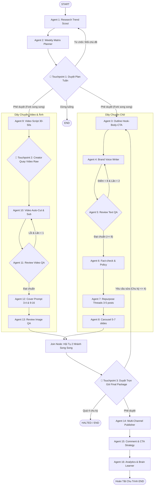

# 🚀 POTA Content OS

> **Hệ thống Multi-Agent Tự Động Hóa Sản Xuất & Phân Phối Nội Dung Đa Kênh Khép Kín**  
> Xây dựng trên nền tảng **LangGraph 0.2+ (Cyclic StateGraph + DAG Fork-Join)** với kiến trúc 16 AI Agents chuyên trách, 3 Human Touchpoints và giao diện Web Dashboard điều khiển trực quan theo thời gian thực.

---

## 📋 Mục Lục
1. [Tổng quan hệ thống](#-tổng-quan-hệ-thống)
2. [Cấu trúc ma trận 16 Agents & 3 Human Touchpoints](#-cấu-trúc-ma-trận-16-agents--3-human-touchpoints)
3. [Hướng dẫn cài đặt trên máy mới](#-hướng-dẫn-cài-đặt-trên-máy-mới)
4. [Hướng dẫn sử dụng](#-hướng-dẫn-sử-dụng)
   - [Cách 1: Giao diện Web Dashboard Trực Quan](#1-chạy-giao-diện-web-dashboard-visual-ui)
   - [Cách 2: Chạy tương tác qua Terminal (CLI)](#2-chạy-tương-tác-qua-terminal-interactive-cli)
   - [Cách 3: Chạy tự động không dừng (Demo CI/CD)](#3-chạy-tự-động-không-dừng-demo-cicd)
5. [Cấu trúc thư mục dự án](#-cấu-trúc-thư-mục-dự-án)
6. [Cơ chế tự sửa bài & Loop Breakers](#-cơ-chế-tự-sửa-bài--loop-breakers)
7. [Chạy kiểm thử tự động (Unit Tests)](#-chạy-kiểm-thử-tự-động)

---

## 🌟 Tổng Quan Hệ Thống

**POTA Content OS** giải phóng 80% thời gian sản xuất và phân phối nội dung hàng tuần cho Solopreneurs, Content Creators và Doanh nghiệp với các khả năng vượt trội:

- **Khả năng thích ứng đa ngành (Multi-Industry Semantic Intent):**
  - Tự động nhận diện bản chất đề tài: Nông sản, đặc sản vùng miền, F&B ẩm thực, thời trang, bất động sản, tài chính cá nhân, giáo dục hay công nghệ.
  - Sử dụng văn phong thuần Việt, đời sống, tự nhiên; **tuyệt đối không gượng ép văn mẫu startup sáo rỗng** vào các chủ đề ẩm thực, nông sản hay phong cách sống.
- **Phân nhánh song song tự động (Parallel DAG Fork-Join):**
  - **Dây chuyền Chữ (Text Pipeline):** Lập dàn ý $\to$ Viết bài $\to$ Tự chấm điểm & sửa bài (QA Loop $\le 2$) $\to$ Soát lỗi & chính sách $\to$ Chuỗi Threads (3-5 posts) $\to$ Kịch bản Carousel (5-7 trang).
  - **Dây chuyền Video & Ảnh (Visual Pipeline):** Kịch bản video dọc 30-50s $\to$ Creator quay clip thô $\to$ Auto-cut, ghép sub & B-roll $\to$ QA kỹ thuật $\to$ Prompt ảnh cover 3:4 & 9:16 $\to$ QA nhận diện thương hiệu.
- **Hội tụ dữ liệu tại Human Touchpoint 3:** Con người duyệt trọn gói toàn bộ ấn phẩm (Text + Threads + Carousel + Video + Cover) trước khi xuất bản.
- **Tự động xuất bản đa nền tảng:** Kết nối phát hành đồng bộ lên **Facebook, TikTok, Threads, YouTube Shorts**.
- **Chăm sóc cộng đồng & Tự học hỏi tuần:** Tự động lên kịch bản phản hồi bình luận theo từ khóa CTA và **bổ sung bài học mới vào Brand Brain** (`brand_rules`) qua cơ chế reducer `operator.add`.
- **Giao diện điều khiển Web Dashboard:** Phong cách Cyberpunk Dark Mode với bộ đếm `REC AI · 16 AGENT` trực quan thời gian thực, font chữ **Be Vietnam Pro** hiển thị tiếng Việt hoàn hảo.

---

## 🤖 Cấu Trúc Ma Trận 16 Agents & 3 Human Touchpoints



---

## 💻 Hướng Dẫn Cài Đặt Trên Máy Mới

### 1. Yêu cầu tiên quyết
- **Python:** 3.10 trở lên (khuyên dùng Python 3.11 hoặc 3.12, tương thích hoàn toàn Python 3.15).
- **Git:** Đã cài đặt trên máy.

### 2. Tải mã nguồn (Clone repository)
```bash
git clone https://github.com/phongnt911/content_os.git
cd content_os
```

### 3. Khởi tạo môi trường ảo (Virtual Environment)
- **Trên Windows (PowerShell):**
  ```powershell
  python -m venv venv
  .\venv\Scripts\activate
  ```
- **Trên macOS / Linux:**
  ```bash
  python3 -m venv venv
  source venv/bin/activate
  ```

### 4. Cài đặt các thư viện phụ thuộc
```bash
pip install -r requirements.txt
```

### 5. Cấu hình file môi trường `.env`
Tạo file `.env` tại thư mục gốc (hoặc copy từ `.env.example`):
```bash
cp .env.example .env
```
Mở file `.env` và điền API Key:
```ini
# Ưu tiên Google Gemini (Khuyên dùng gemini-3.5-flash-lite tốc độ cao, miễn phí)
GOOGLE_API_KEY=your_google_gemini_api_key_here

# Hoặc OpenAI
OPENAI_API_KEY=your_openai_api_key_here

# Cấu hình model mặc định
LLM_CORE_MODEL=gemini-3.5-flash-lite
LLM_FAST_MODEL=gemini-3.5-flash-lite
LLM_TEMPERATURE=0.7

# Tuần mặc định
DEFAULT_WEEK_ID=2026-W42
```
> **Cơ chế MockLLM Fallback thông minh:** Kể cả khi chưa có API Key hoặc hết quota (429), toàn bộ luồng đồ thị và các unit test vẫn tự động chạy ổn định nhờ hệ thống mock nội bộ.

---

## 🎯 Hướng Dẫn Sử Dụng

### 1. Chạy Giao Diện Web Dashboard (Visual UI)
Khởi chạy máy chủ HTTP:
```bash
python server.py
```
👉 Mở trình duyệt truy cập: **`http://localhost:8080`**

**Các tính năng nổi bật trên giao diện Web:**
- **Đèn REC AI nhấp nháy & Bộ đếm Realtime:** Thể hiện chính xác số lượng Agent đang xử lý (`02/16 AGENT ĐANG CHẠY`).
- **Thanh nhập chủ đề:** Cho phép nhập bất kỳ ngành nghề nào (ví dụ: *"xoài cam lâm"*, *"kinh doanh F&B"*, *"thời trang công sở"*, *"đầu tư căn hộ"*...) hoặc để trống để AI tự quét radar.
- **Modal Touchpoint 1 (Duyệt Plan):**
  - Hiển thị danh sách các bài viết do Gemini LLM thiết lập.
  - Hỗ trợ đổi hướng đề tài: Nếu chưa ưng ý, bấm *"✕ Từ chối / Đổi hướng đề tài"*, hệ thống sẽ hỏi nhu cầu mới và lập lại kế hoạch theo định hướng vừa nhập.
  - Hỗ trợ dừng luồng an toàn: Đưa bộ đếm về `00/16` và mở lại nút chạy, không bị treo.
- **Modal Touchpoint 2 (Quay Video):** Xem kịch bản máy nhắc chữ (Voice prompter, visual cues) và nạp link Google Drive video thô.
- **Modal Touchpoint 3 (Duyệt Trọn Gói):** Tab xem trước Bài Facebook, chuỗi bài Threads, Carousel slides, Video dựng và Ảnh bìa Thumbnail trước khi xuất bản.
- **Terminal Logs:** Theo dõi dòng chạy dữ liệu của 16 Agents theo thời gian thực.

---

### 2. Chạy tương tác qua Terminal (Interactive CLI)
```bash
python main.py
```
Quy trình dòng lệnh:
1. Nhập chủ đề trọng tâm tuần (hoặc nhấn **Enter** để AI tự quét radar).
2. **Touchpoint 1:** Chọn bài viết muốn sản xuất (`1` - `6`), duyệt nhanh (`Y`), nhập chủ đề mới (`C`), hoặc từ chối kế hoạch (`N`). Nếu từ chối, hệ thống sẽ hỏi định hướng mới để chuyển hướng sản xuất.
3. **Touchpoint 2:** Đọc kịch bản 3 phân cảnh và dán link Google Drive video thô.
4. **Touchpoint 3:** Xem trước toàn bộ ấn phẩm và bấm `Y` để xuất bản đa kênh.
5. Xem báo cáo kết thúc chu trình: Link bài đăng đa kênh, số liệu đo lường và bài học mới được cập nhật vào Brand Brain.

---

### 3. Chạy tự động không dừng (Demo CI/CD)
Dùng để chạy thử nghiệm nhanh toàn bộ quy trình mà không cần con người tương tác:
```bash
python main.py --auto
```

---

## 📁 Cấu Trúc Thư Mục Dự Án

```text
content_os/
├── config.py                     # Quản lý LLM (Gemini, OpenAI, MockLLM) & env vars
├── requirements.txt              # Danh sách thư viện Python
├── .env.example                  # Mẫu cấu hình API keys
├── .gitignore                    # Bỏ qua venv, cache, file bảo mật
├── README.md                     # Tài liệu hướng dẫn sử dụng và cài đặt
├── PROJECT_SPEC.md               # Tài liệu đặc tả kỹ thuật chi tiết
├── server.py                     # Web Dashboard Server kết nối StateGraph REST API
├── ui/                           # Giao diện Visual Control Board thời gian thực
│   ├── index.html                # Cyberpunk dashboard 16 Agents & 3 Modals
│   ├── style.css                 # CSS glassmorphism & typography Be Vietnam Pro
│   └── app.js                    # Bộ điều khiển frontend kết nối trực tiếp StateGraph
├── core/
│   ├── __init__.py
│   ├── state.py                  # ContentOSState TypedDict & Pydantic V2 Schemas
│   └── checkpointer.py           # MemorySaver checkpointer cho LangGraph
├── agents/
│   ├── planning/
│   │   ├── research_agent.py     # Agent 1: Quét xu hướng đa ngành & bám sát đề tài
│   │   └── planner_agent.py      # Agent 2: Lập ma trận 5-7 bài/tuần
│   ├── text_pipeline/
│   │   ├── outline_agent.py      # Agent 3: Dàn ý Hook - Body - CTA
│   │   ├── writer_agent.py       # Agent 4: Chấp bút chuẩn Brand Voice
│   │   ├── review_agent.py       # Agent 5: Chấm điểm QA (0-10)
│   │   ├── factcheck_agent.py    # Agent 6: Soát chính tả & chính sách
│   │   ├── repurpose_agent.py    # Agent 7: Tách chuỗi Threads (3-5 post)
│   │   └── carousel_agent.py     # Agent 8: Soạn kịch bản slide (5-7 trang)
│   ├── media_pipeline/
│   │   ├── script_agent.py       # Agent 9: Kịch bản video dọc 30-50s
│   │   ├── video_editor.py       # Agent 10: Auto-cut, sub, B-roll interface
│   │   ├── review_video.py       # Agent 11: QA thời lượng < 60s & phụ đề
│   │   ├── cover_agent.py        # Agent 12: Prompt & layout ảnh bìa 3:4 / 9:16
│   │   └── review_image.py       # Agent 13: QA nhận diện thương hiệu
│   └── operations/
│       ├── publisher_agent.py    # Agent 14: API đăng đa kênh (FB, TikTok, Threads, Shorts)
│       ├── community_agent.py    # Agent 15: Phân loại & trả lời bình luận theo CTA
│       └── analytics_agent.py    # Agent 16: Phân tích tuần & tự bổ sung Brand Rules
├── graph/
│   ├── __init__.py
│   ├── nodes.py                  # Đóng gói các node trong đồ thị LangGraph
│   ├── edges.py                  # Các hàm điều kiện rẽ nhánh & vòng lặp
│   └── workflow.py               # Biên dịch StateGraph hoàn chỉnh
└── tests/
    ├── test_state_and_planning.py    # Unit test Phase 1 (State & Planning)
    ├── test_phase2_graph.py          # Unit test Phase 2 (Touchpoint 1)
    ├── test_phase3_text_pipeline.py  # Unit test Phase 3 (Text Self-Correction)
    ├── test_phase4_media_pipeline.py # Unit test Phase 4 (Media & DAG Fork-Join)
    └── test_phase5_operations.py     # Unit test Phase 5 (Operations & End-to-End)
```

---

## 🛡️ Cơ Chế Tự Sửa Bài & Loop Breakers

Hệ thống được thiết kế theo chuẩn kỹ thuật khắt khe nhằm đảm bảo độ tin cậy và kiểm soát ngân sách:
1. **Self-Correction Dây chuyền Chữ:** Nếu bài viết của Agent 4 có điểm QA < 8 điểm, hệ thống tự động đưa feedback để viết lại. Chốt chặn: **Tối đa 2 lần sửa** (`text_revision_count < 2`).
2. **Video Editing Correction:** Nếu video render bị lỗi kỹ thuật hoặc quá 60s, hệ thống yêu cầu cắt dựng lại. Chốt chặn: **Tối đa 1 lần render lại** (`video_revision_count < 1`).
3. **Touchpoint 3 Loop Breaker:** Nếu con người yêu cầu sửa gói ấn phẩm, đồ thị cho phép lặp lại tối đa 4 lần. Vượt quá 4 chu kỳ (`total_cycle_count > 4`), hệ thống tự động kích hoạt trạng thái **HALTED** để chống lặp vô hạn và tràn chi phí token.
4. **DAG Fork State Isolation:** Trong nhánh chạy song song giữa Text và Video, các node độc lập chỉ cập nhật các trường riêng (`outline` và `video_script`), tránh hoàn toàn xung đột ghi đè đồng thời trên cùng một state key.

---

## 🧪 Chạy Kiểm Thử Tự Động

Dự án sở hữu bộ test suite bao phủ toàn diện 24 ca kiểm thử:
```bash
pytest -v tests/
```
Kết quả kiểm thử chuẩn:
```text
tests/test_phase2_graph.py ......................... PASSED (3/3)
tests/test_phase3_text_pipeline.py .................. PASSED (5/5)
tests/test_phase4_media_pipeline.py ................. PASSED (6/6)
tests/test_phase5_operations.py ..................... PASSED (5/5)
tests/test_state_and_planning.py .................... PASSED (5/5)
======================= 24 passed in 51.80s =======================
```

---

## 📜 Giấy Phép & Bản Quyền
Dự án được phát triển và vận hành bởi **POTA**. Mọi đóng góp và mã nguồn được chia sẻ theo giấy phép MIT License.
